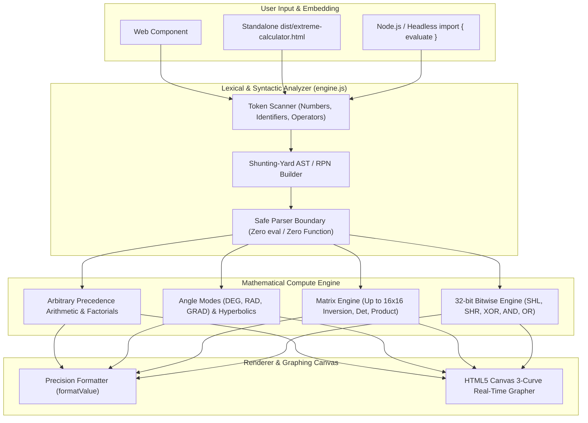
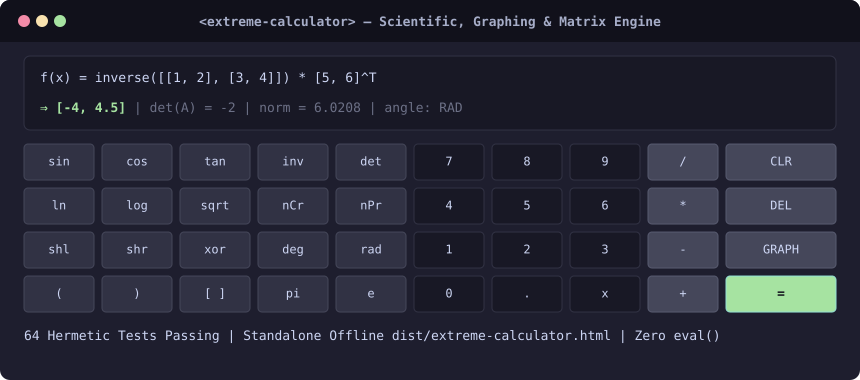

# EHXTREAM_CALC (Extreme Calculator) 🧮

A small, high-performance scientific and graphing calculator embeddable in any web application: a dependency-free mathematical expression engine plus a `<extreme-calculator>` Web Component, featuring a standalone offline build.

> *"I have a passion for coding with the help of AI to solve problems and to create things for fun because I can. To make that work at scale, AI agents need solid engineering foundations, deep documentation, and rigorous boundaries."*  
> — **Ethan (TWU LLC)**

[](https://github.com/Ethan-da-Tech-Wizard/EHXTREAM_CALC/actions)
[](LICENSE)
[](https://nodejs.org/)
[](MAGI_BIBLE.md)
[](MAGI_BIBLE.md)

---

## What It Does & Architecture

I wanted a calculator that could be dropped into another app without a framework, an account, or network calls, and that evaluates typed expressions safely without `eval()`.



---

## Visual Walkthrough & Component Previews

### Embeddable Web Component & Standalone Offline Canvas
Features a tactile keyboard, function catalog modal, history pane, and real-time canvas curve tracing:

<p align="center">
  
</p>

```text
======================================================================
  🧮 EXTREME CALCULATOR: ZERO-DEPENDENCY SCIENTIFIC & GRAPHING ENGINE
======================================================================
f(x) = inverse([[1, 2], [3, 4]]) * [5, 6]^T
⇒ [-4, 4.5]  | det(A) = -2 | norm = 6.0208 | angle: RAD
64 Hermetic Tests Passing | Standalone Offline dist/extreme-calculator.html | Zero eval()
======================================================================
```

---

## Quick Start

Needs Node 20 or newer (developed on Node 24). No install step, no dependencies.

```sh
npm test            # engine tests, no browser needed (64 hermetic tests)
npm start           # demo server at http://localhost:4173
npm run build       # writes dist/ bundles (HTML, JS, gz, br)
```

Use the engine from Node:

```js
import { evaluate, formatValue } from './engine.js';

evaluate('2+3*4');                           // 14
evaluate('sin(30)', { angle: 'deg' });       // 0.49999999999999994
evaluate('inverse([[1,2],[3,4]])');          // [[-1.9999999999999996, 0.9999999999999998], [1.4999999999999998, -0.49999999999999994]]
formatValue(evaluate('10!'));                // '3628800'
evaluate('1/0');                             // throws Error('Division by zero')
```

Embed the UI (serve over HTTP, or open `dist/extreme-calculator.html` straight from disk):

```html
<script type="module" src="/calculator.js"></script>
<extreme-calculator storage-key="my-app-math"></extreme-calculator>
```

---

## Engineering Standards & Magi Bible

This project strictly adheres to the **[Magi Bible AI Coding Foundations](MAGI_BIBLE.md)**:
* **Rule 16 Comment Density ($\ge 25\%$):** Every mathematical method, Shunting-yard rule, and matrix inversion algorithm contains comprehensive rationale comments.
* **Security Invariant:** Never invokes `eval()` or `new Function()`. User expressions are strictly parsed into token streams and evaluated against a frozen whitelist of mathematical operations.
* **Hermetic Reproducibility:** 64 property and unit tests run in <500ms with zero network access.

---

## Repository Layout

| Path | Role |
| :--- | :--- |
| `engine.js`, `engine.test.js` | Expression engine and its 64-test automated suite. |
| `calculator.js`, `index.html`, `demo.css` | Web component and interactive demo page. |
| `index.d.ts`, `calculator.d.ts` | Complete TypeScript declarations. |
| `scripts/` | `build.mjs` (bundler) and `serve.mjs` (demo server). |
| `dist/` | Standalone single-file HTML and bundled JavaScript. |
| `docs/` | Project guide, per-file guide, license and dependency review. |

---

## Contributing

See [CONTRIBUTING.md](CONTRIBUTING.md) and the [Code of Conduct](CODE_OF_CONDUCT.md).

---

## License

MIT, see [LICENSE](LICENSE). Copyright holder: Ethan-da-Tech-Wizard.
Third-party material keeps its own terms; see the [license review](docs/LICENSE_REVIEW.md) and [dependency inventory](docs/DEPENDENCIES.csv).
